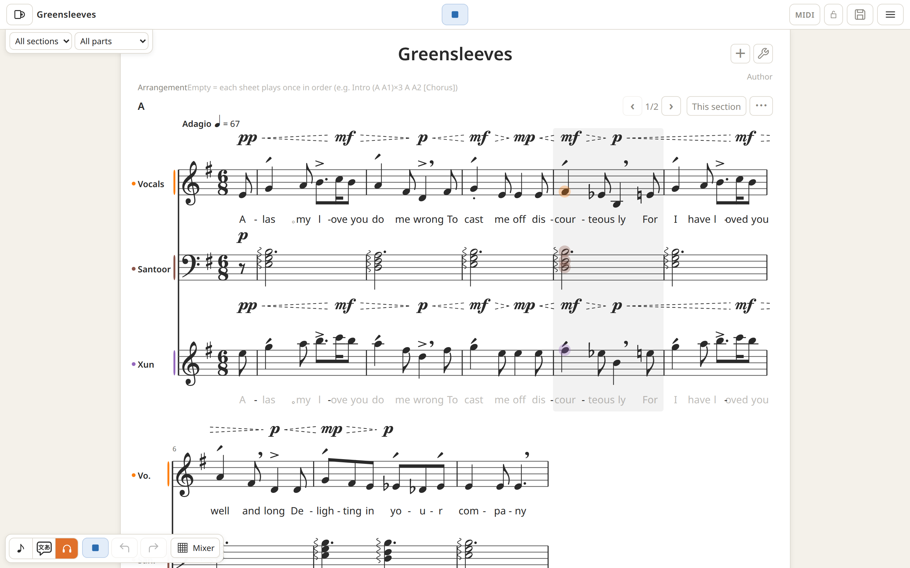
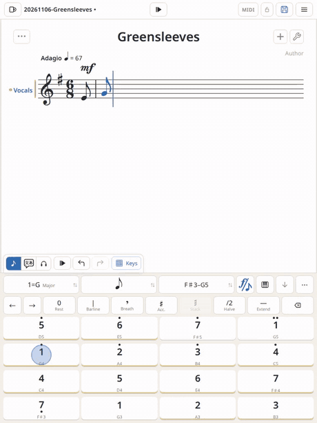
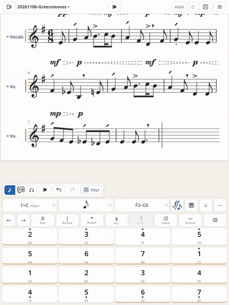

<!-- rewritten by Claude Opus 5.5 · 2026-11-06 -->

# MoonSinger


Sing before writing a song. MoonSinger is an open-source music-making app (a DAW) that runs in the browser, on iPad, phones, and desktops. Write staff notation and lyrics, let Tsukuyomi-chan sing them, arrange with GS instruments, mix, and export an mp3. No account, no installation, no server.

- **Use it:** https://sing.weebpaint.com/
- **Standalone version:** a zip that runs from a double-click on `index.html` — [GitHub Releases](https://github.com/fangzhangmnm/moonsinger/releases) or [itch.io](https://fangzhangmnm.itch.io/moonsinger).
- **Video:** [MoonSinger tech demo on YouTube](https://www.youtube.com/watch?v=llTEyZCwDPs)

> as-of v0.15.4 · 2026-11-06



 

## Features

Singing

- Tsukuyomi-chan (つくよみちゃん) sings Japanese, Chinese, and English lyrics. A new song starts with her as the default instrument.
- Notes without lyrics are hummed.
- The voice model is about 68 MB, downloaded once on first use. A lightweight vowel sampler answers the moment you press a key.

Writing

- Real staff notation: multiple parts, multiple sheets (sections), grand staff, clefs, octave lines, repeats and jumps.
- A touch keyboard for iPad and phones, modeled on the Donner MEDO: keys are scale degrees and follow the key and mode.
- Computer keyboard, mouse, and pen input; MIDI keyboards in browsers with Web MIDI.
- Undo and redo for the score, the casting, and the mix.

Expression

- Written as marks, not curves: dynamics (ppp to fff), hairpins, accents, staccato, tenuto, slurs, breaths, whispers, sfz, fp, arpeggios.
- Each performer has its own table for reading the marks, so changing the instrument does not mean rewriting them.
- Style marks for beat weight (classical, pop, waltz, march, swing, bossa, and more).
- Marks a performer cannot play are shown in gray with the reason. The same goes for lyrics it cannot sing.

Instruments

- A catalog you can browse by genre, era, instrument family, or sound source, with a keyboard to try each one.
- GeneralUser GS 2.0.3 (32 MB, downloaded when you first need it), or your own `.sf2` files.
- Sounds can be linked or packed into the song file.

Playback and mixing

- Real-time playback from any bar, with looping.
- Mixer: gain, pan, mute, solo, EQ, compressor with sidechain, reverb, delay, chorus, sends, buses, master limiter.
- Meters, spectrum, and stereo scopes.

Files

- Songs are `.mxl` (compressed MusicXML), which other notation software can open. MoonSinger's own data lives in a `.moonsinger/` folder inside the file. Format notes: [ai-docs/20261007-data-contract-draft.md](ai-docs/20261007-data-contract-draft.md).
- Export mp3, PDF scores, and MusicXML.
- A reference window for screenshots, text, and audio while you transcribe.
- Library in a local folder or in OneDrive (personal Microsoft accounts; the app can only access its own `Apps/MoonSinger/` folder).
- No library needed: you can also just open and save files.

Platform

- Installable PWA, works offline once installed.
- UI languages: English, 中文.

## Install as an app (PWA)

Open https://sing.weebpaint.com/ in the browser, then:

- **iPad / iPhone:** Share → "Add to Home Screen".
- **Windows / Mac (Chrome / Edge):** install icon in the address bar.

## Shortcuts

The generated list is in [docs/keys.md](docs/keys.md) (Chinese for now).

Basics: `1`–`7` write a note, `0` a rest, `Space` plays, `Ctrl+S` saves.

## Coming soon

- Live recording of your own singing and playing.
- Numbered notation (jianpu) and piano roll.
- A math-and-code DSP interface, for AIs that want to make music.

## Technical notes

- The `/dev/` path on sing.weebpaint.com serves the development branch. It is a working area and can be broken mid-change.
- iPad and iPhone browsers have no Web MIDI, so MIDI keyboards work on desktop only.
- Nothing you sing or write leaves your device except through the cloud library you choose. Voice model and sound files are verified by SHA-256 when downloaded.
- This is a public workshop: `ai-docs/` is developed in the open along with the code.

## Running it

```
npm install          # only for the tsc type gate and the vendored family libraries
npm test             # node 24 runs test/ directly
bash scripts/build.sh
npm run serve        # http://localhost:8710/
npm run smoke        # real browser + real service worker smoke test
```

Where to read next: [CLAUDE.md](CLAUDE.md) (repo rules and history), [ai-docs/20261005-moonsinger-upheaval.md](ai-docs/20261005-moonsinger-upheaval.md) (why Tsukuyomi-chan), [docs/keys.md](docs/keys.md) (keys).

## Tsukuyomi-chan's voice

本ソフトウェアの音声合成には、フリー素材キャラクター「つくよみちゃん」（© Rei Yumesaki）が無料公開している音声データを使用しています。
■つくよみちゃんコーパス（CV.夢前黎）
https://tyc.rei-yumesaki.net/material/corpus/

つくよみちゃんの声質を使用する場合は、出力した音声を次の目的で使用することを禁止します。
【禁止事項】
■人を批判・攻撃すること。（「批判・攻撃」の定義は、つくよみちゃんキャラクターライセンスに準じます）
■特定の政治的立場・宗教・思想への賛同または反対を呼びかけること。
■刺激の強い表現をゾーニングなしで公開すること。
■他者に対して二次利用（素材としての利用）を許可する形で公開すること。

- ayousanz/piper-plus-tsukuyomi-chan — つくよみちゃんコーパス利用規約 (modified: zh / en language vectors)
- ayousanz/piper-plus-base — CC-BY-4.0 (zh / en language vectors)
- Open JTalk · MeCab · NAIST-jdic · pyopenjtalk-plus · CMUdict · g2p-en · pypinyin · ONNX Runtime

Illustration of Tsukuyomi-chan in the banner: fangzhangmnm.

## License

- The code and docs written in this repo: MIT ([LICENSE](LICENSE)). Most of the code was written with Claude Code.
- Third-party code and fonts under `vendor/` keep their own licenses: Bravura (SIL OFL 1.1), LAME (LGPL v2, our own WASM build, `vendor/lame/`), WORLD (modified BSD). The original texts are in each folder.
- `assets/preview/` (the preview vowel table) is sung by Tsukuyomi-chan and falls under her terms above, not MIT.
- Models (packs from the family repo `pwa-models`) carry their own licenses.
- Instruments: GeneralUser GS 2.0.3 by S. Christian Collins, via the family sound repo `pwa-sounds`.
